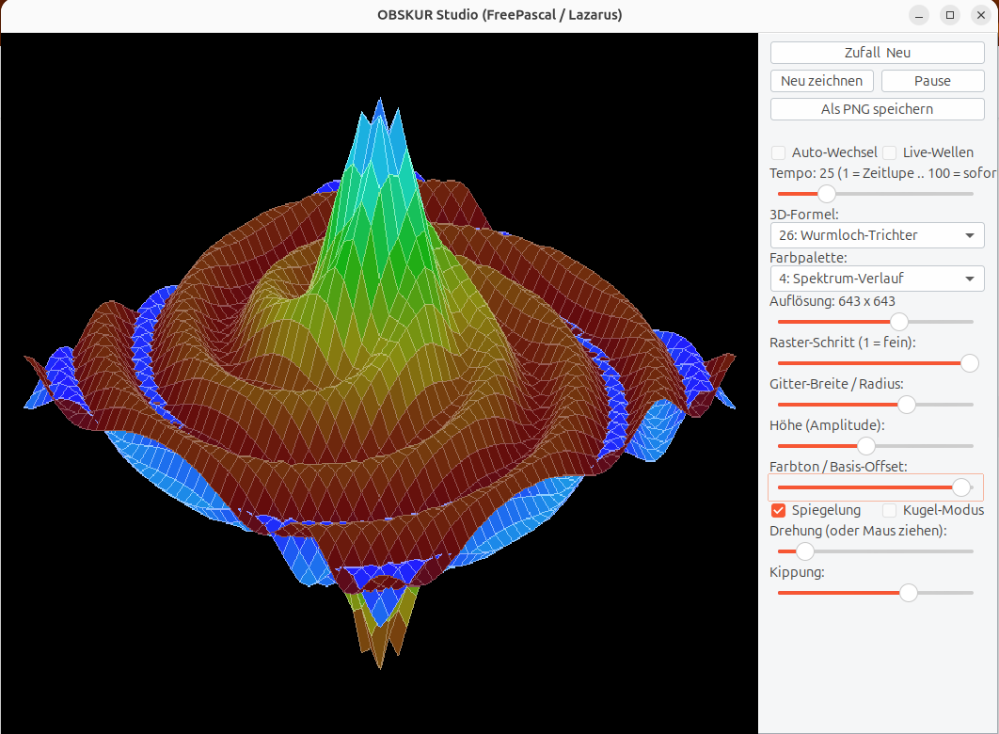

# OBSKUR Studio (1990 → 2026)



Ein interaktiver 3D-Funktions- und Skulpturen-Generator in **FreePascal / Lazarus** für **Linux, macOS und Windows**.

## Hintergrund & Geschichte
Das ursprüngliche Programm **`obskur.exe`** entstand im Jahr **1990** in **Turbo Pascal** (mit der klassischen BGI-Grafikbibliothek im 16-Farben-EGA-Modus) und zeichnete damals isometrische 3D-Wellenlandschaften Polygon für Polygon auf DOS-PCs.

Im Jahr **2026** wurde die alte 16-Bit-DOS-Datei durch Reverse Engineering rekonstruiert und zu einer modernen, plattformübergreifenden **64-Bit-Desktop-Anwendung** weiterentwickelt – mit 24-Bit TrueColor, interaktiver 3D-Mausrotation, Kugel-Projektion und 28 mathematischen 3D-Formeln.

---

## Features
* **28 3D-Formeln:** Von klassischen Sinus-Kosinus-Wellen und dem Mexikanerhut über Vulkankrater, Spiralgalaxien und Mandelbrot-Fraktale bis hin zu organischer Plasma-Turbulenz (Domänen-Verzerrung).
* **Ebene & Kugel-Modus (Sphäre):** Jede Formel lässt sich wahlweise als klassisches 3D-Gitter oder gewickelt um eine geschlossene 3D-Kugel (inkl. Tiefensortierung / Painter's Algorithm) darstellen.
* **Doppel-Spiegelung:** Optionales Spiegeln der Wellenform nach oben und unten zu schwebenden 3D-Skulpturen.
* **5 TrueColor-Farbpaletten:** *Klassik (Einfarbig mit 3D-Schattierung)*, *Lava & Glut*, *Tiefsee & Ozean*, *Nordlicht (Aurora)* und *Spektrum-Verlauf*.
* **Interaktive 3D-Steuerung:**
  * **Maus-Drag:** Mit gedrückter linker Maustaste direkt im Bild ziehen, um die Skulptur frei zu drehen und zu kippen.
  * **Variable Auflösung:** Frei einstellbar von `64 × 64` bis `1024 × 1024` Gitterpunkten.
  * **Aufbau-Animation & Live-Wellen:** Retro-Aufbau Viereck für Viereck (Tempo `1` bis `100`) oder flüssige Echtzeit-Wellenbewegung (*Live-Wellen*).
  * **Auto-Fit:** Automatische Skalierung und Zentrierung, damit keine Skulptur über den Fensterrand hinausragt.
* **PNG-Export:** Direkter Export des aktuellen Kunstwerks als hochauflösende PNG-Datei (`obskur_<timestamp>.png`).

---

## Download (Linux, macOS & Windows)
Fertig kompilierte 64-Bit-Versionen für alle drei Betriebssysteme stehen direkt auf der **[Releases-Seite](../../releases/latest)** zum Download bereit:

* **Linux (64-Bit):** `OBSKUR-Linux-x86_64.zip`
* **macOS (Apple Silicon / Cocoa):** `OBSKUR-macOS-AppleSilicon.zip`
* **Windows (64-Bit):** `OBSKUR-Windows-x64.zip`

### Hinweise zum Starten der heruntergeladenen Dateien
* **Linux:** Nach dem Entpacken im Terminal ausführbar machen und starten:
  ```bash
  chmod +x obskur-linux-x86_64
  ./obskur-linux-x86_64
  ```
* **macOS:** Da die App nicht über den Apple App Store signiert ist, beim allerersten Start im Finder **Rechtsklick auf `obskur.app` → „Öffnen“** wählen.
* **Windows:** Entpacken und `obskur.exe` direkt per Doppelklick starten (bei SmartScreen ggf. *„Weitere Informationen → Trotzdem ausführen“* wählen).

---

## Selbst kompilieren

### Voraussetzungen
* **FreePascal (`fpc`)** und **Lazarus (`lazbuild`)** (getestet mit Lazarus 4.4 / FPC 3.2.2)
* Unter Ubuntu/Debian zusätzlich `libgtk2.0-dev` (für GTK2) oder `libgtk-3-dev` (für GTK3)

### Bauen über die Kommandozeile
```bash
# Linux (GTK2)
lazbuild obskur.lpi
./lib/x86_64-linux/obskur

# macOS (Cocoa)
lazbuild --ws=cocoa --opt="-k-ld_classic" obskur.lpi

# Windows (Win32/Win64)
lazbuild --ws=win32 obskur.lpi
```

Alternativ kann `obskur.lpi` direkt in der **Lazarus IDE** geöffnet und mit `F9` gestartet werden.

---

## Lizenz
Dieses Projekt steht unter der **GNU General Public License v3.0 (GPL-3.0)** – siehe [LICENSE](LICENSE).
